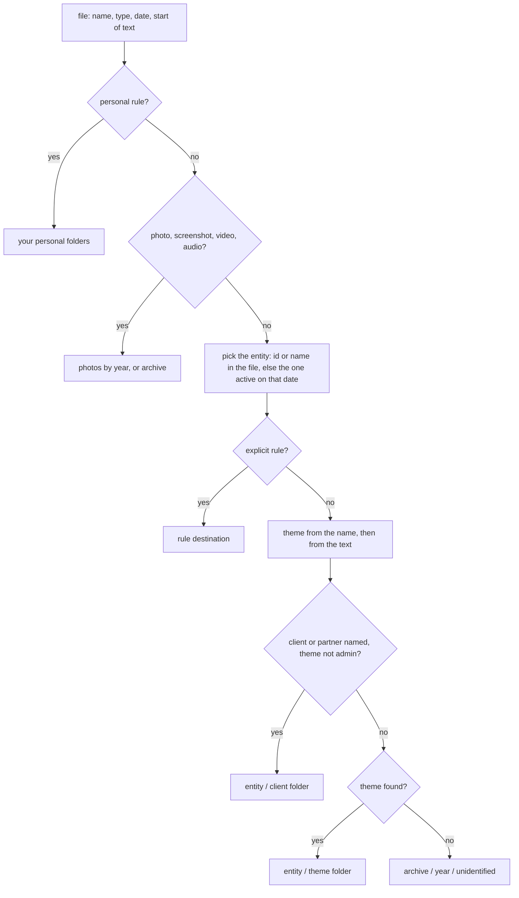

# tidy-downloads

Sort a messy Downloads folder into your own folder tree, from rules you own. It plans first,
moves only when you say so, and can put everything back.

My Downloads folder held 8,722 files and 10.4 GB, going back years: invoices, contracts,
payslips, decks, data exports, photos, installers, and 248 exact duplicates. I wrote a script
with Claude to sort it into my Documents folder. About 3 % of files stayed unidentified and went
to an archive folder for a manual look. Nothing was deleted or overwritten, and every move was
journalled so it could be undone.

The script only worked for me: its rules were full of my clients, my companies and my life.
This is the same engine with the rules moved out into a file you write yourself.

## What it does

- Reads each file's name, type, date and, for PDF and Word files, the start of its text.
- Decides a destination with a cascade of rules you control (below), and writes a plan you can read and edit.
- Moves files without ever overwriting: a name clash gets a `(dl-2)` suffix, an exact copy already in place goes to an archive folder.
- Keeps a journal, one line per move, so `undo` puts everything back and an interrupted run can resume.
- Explains any decision: `tidy-downloads explain <file>` shows the rule and the keyword that decided.

## What it does not do

- Delete anything. Duplicates and noise are archived, not removed.
- Learn on its own. Rules are yours; the optional `--llm` flag only suggests folders for unidentified files.
- Send anything anywhere, unless you use `--llm` and confirm.

## Demo in three commands

```bash
pipx install git+https://github.com/korbenmeteo/tidy-downloads
tidy-downloads plan          # first time: it tells you where to copy the example rules
tidy-downloads apply --limit 1
```

Then `tidy-downloads apply` for the rest, and `tidy-downloads undo` if you change your mind.
Add `tidy-downloads scan` before `plan` to let it read the start of PDF and Word files
(`pdftotext` from Poppler, or `pip install "tidy-downloads[pdf]"`).

## How a file is decided

The first rule that matches wins.



Rules live in one TOML file: entities (with start and end dates), themes and their keywords,
explicit rules (regexes on the name or the text), clients and partners, personal rules, and whole
folders to move as they are. `rules.example.toml` covers a small company and its owner, with comments.

## Lessons built in

- **macOS file names are NFD.** Names are normalised before any comparison, and non-breaking spaces (common in e-signature downloads) are treated as spaces.
- **Short keywords need word boundaries.** Otherwise `nda` matches `calendar` and `irm` matches `confirmation`. A digit counts as a boundary.
- **Company names are removed before themes.** A company called "Apple Ltd" would send its invoices to a fruit folder.
- **Spreadsheet text is ignored for themes.** A sales pipeline mentioned "invoice" and "certification" on every row.
- **A date in the name wins** over the file date, when it is plausible.
- **A supplier can use your invoice numbering.** An invoice counts as issued only if your name is on it.
- **Across volumes, a move is a copy then a delete.** The tool checks it can delete before copying, so a read-only source never ends up duplicated.
- **Temporary names are short and hashed.** Adding `.part` to a 250-byte name breaks the file-name limit.
- **The journal is flushed after every move.** An interruption loses nothing; `reconcile` catches the move that happened between the copy and the journal line.
- **Eight threads** moved files about four times faster than one.

## Privacy

`scan` keeps the first 600 characters of each PDF and Word file in a local cache. Plans and
journals list your file names. All of it stays in your user state folder (for example
`~/Library/Application Support/tidy-downloads` on macOS, `~/.local/state/tidy-downloads` on Linux),
never in a repository. Treat the cache like the documents themselves.

`--llm` sends the names and the first 300 characters of unidentified files to Claude, through the
`claude` command-line tool. It is off by default, asks before sending, and only accepts folders
that already exist in the plan.

## How it was tested

- Unit tests on dates in names, word boundaries, Unicode, the rule cascade and `explain`.
- About 200 synthetic files (generated PDFs, NFD names, duplicates, a 244-byte name, supplier invoices with your numbering): `plan`, `apply`, then `undo` restores the tree byte for byte.
- An interrupted run, a cross-volume move and a read-only source, simulated.
- On my own Downloads history, the rebuilt engine with my private rules made the same decision as the original script for every one of 5,276 files.

```bash
python -m unittest discover -s tests   # with PYTHONPATH=src:tests
```

## Limits

- macOS and Linux are tested; Windows paths are handled but not tested yet.
- Text is read from PDF, DOCX, XLSX, PPTX, TXT and MD only. Scanned PDFs without a text layer read as empty.
- Rules take an afternoon to get right on a large backlog. `explain` is how you get there.

## Use it with Claude

The repository is also a Claude Code plugin. The skill walks through the inventory, asks three
or four questions, writes your rules, shows the plan, tests one file and moves the rest in batches.

```
/plugin marketplace add korbenmeteo/tidy-downloads
/plugin install tidy-downloads@tidy-downloads
```

## Author

Built by Ruben Hallali ([@RubenHallali](https://x.com/RubenHallali)). I am building my own
tooling in public; issues and pull requests are welcome.

## Licence

MIT
